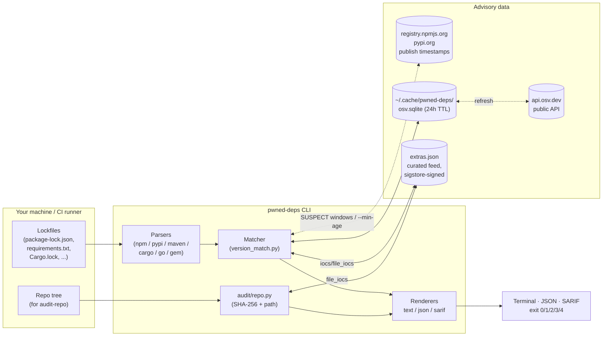
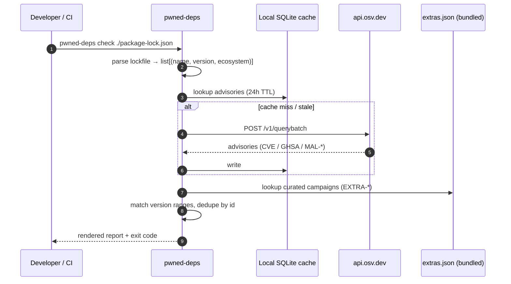

# pwned-deps

> **Drop your lockfile in. Get a red/green answer in 5 seconds — and
> never a green one for a package that wasn't actually checked.**
>
> A multi-ecosystem scanner for compromised package versions —
> account hijacks, typosquats, dependency-confusion, retroactively
> trojanised releases — across npm, PyPI, Maven, Cargo, Go, RubyGems, Packagist.

[](https://github.com/mkbhardwas12/pwned-deps/actions/workflows/ci.yml)
[](https://pypi.org/project/pwned-deps/)
[](https://pypistats.org/packages/pwned-deps)
[](https://pypi.org/project/pwned-deps/)
[](#verify-a-release-with-slsa-provenance)
[](#github-actions-one-line)
[](LICENSE)

```bash
pipx install pwned-deps
pwned-deps check .                 # every lockfile in the tree → exit 0/1/2/3/4
pwned-deps check . --min-age 7     # + refuse anything published < 7 days ago
```

**Why this and not just `npm audit` / `osv-scanner`?** Three things
they don't do:

| | pwned-deps |
|---|---|
| **Campaigns before OSV has them** | A curated, Sigstore-signed feed of named incidents (event-stream → xz → Shai-Hulud → Mini Shai-Hulud) with tarball SHA-256s, IDE-persistence IoCs and remediation steps. A maintainer hijack can be described as a *time window* and confirmed against the registry's publish timestamp for **your** pinned version. |
| **A cooling-off gate** | `--min-age N` blocks versions published fewer than N days ago — the only defence that works in the hours *before* any advisory exists. Works on any lockfile, in any CI. |
| **Honest exit codes** | Offline cache miss? OSV down? You get `UNCHECKED` + exit **4**, not "All clean". A scanner that can't tell "checked, nothing found" from "didn't look" is worse than none. |

**Try it without installing:** the [in-browser lockfile simulator](https://mkbhardwas12.github.io/pwned-deps/simulator.html)
replays `pwned-deps check` against real campaign data.


## Table of contents

- [At a glance](#at-a-glance)
- [Architecture](#architecture)
- [Why this exists](#why-this-exists)
  - [Campaigns the bundled feed already covers](#campaigns-the-bundled-feed-already-covers)
  - [A worked example: Mini Shai-Hulud (April 29, 2026)](#a-worked-example-mini-shai-hulud-april-29-2026)
- [Install](#install)
- [See it in action](#see-it-in-action)
  - [Benchmark](#benchmark)
- [Quick usage](#quick-usage)
- [Watch mode (the recurring-value workflow)](#watch-mode-the-recurring-value-workflow)
- [Supported ecosystems](#supported-ecosystems)
- [Real-world scenarios this is built for](#real-world-scenarios-this-is-built-for)
- [CI integration](#ci-integration)
  - [GitHub Actions (one line)](#github-actions-one-line)
  - [Plain workflow step (no action wrapper)](#plain-workflow-step-no-action-wrapper)
  - [Sticky PR comment (the bot workflow)](#sticky-pr-comment-the-bot-workflow)
  - [Static HTML dashboard (org-wide visibility)](#static-html-dashboard-org-wide-visibility)
  - [pre-commit](#pre-commit)
  - [GitLab CI](#gitlab-ci)
- [Output formats](#output-formats)
- [Threat model](#threat-model)
  - [Verify a release with SLSA provenance](#verify-a-release-with-slsa-provenance)
- [Comparison](#comparison)
  - [Where each tool is the right answer](#where-each-tool-is-the-right-answer)
- [FAQ](#faq)
- [Contributing](#contributing)
- [Maintenance](#maintenance)
- [Changelog](CHANGELOG.md)
- [Security policy](SECURITY.md)
- [License](#license)
- [Maintainer](#maintainer)

`pwned-deps` is a Python CLI that takes one or more developer lockfiles
(`package-lock.json`, `pnpm-lock.yaml`, `yarn.lock`, `composer.lock`, `requirements.txt`,
`Pipfile.lock`, `poetry.lock`, `uv.lock`, `Cargo.lock`, `go.sum`,
`pom.xml`, `Gemfile.lock`) and tells you, in seconds, whether you've
installed a package version that's publicly flagged as compromised —
supply-chain malware, abandoned-and-hijacked packages, retroactively
published malicious versions.

## At a glance

|                       |                                                                 |
|-----------------------|-----------------------------------------------------------------|
| **What**              | A 5-second red/green answer to "is anything in my lockfile pwned?" |
| **Who it's for**      | Application devs, SREs, AppSec / DFIR responders during an active incident |
| **Inputs**            | Lockfiles (npm, PyPI, Maven, Cargo, Go, RubyGems, Packagist) and CycloneDX / SPDX SBOMs — never source, never tarballs |
| **Data sources**      | [OSV.dev](https://osv.dev) public API + curated `extras.json` campaign feed (signed, sigstore + Rekor) + registry publish timestamps (npm, PyPI) to resolve maintainer-compromise windows and enforce `--min-age` |
| **Outputs**           | Coloured terminal report, JSON, SARIF (GitHub Code Scanning) |
| **Four commands**     | `pwned-deps check <lockfile>` (one-shot scan) · `pwned-deps audit-repo <dir>` (forensic file-IoC scan) · `pwned-deps watch <lockfile> --baseline <file>` (daily baseline + delta alert) · `pwned-deps report <scans> -o <html>` (org-wide HTML dashboard) |
| **Failure mode**      | Exit `1` on confirmed compromise — wire that to your CI gate. Exit `4` when a scan is *incomplete* (a pinned package could not be looked up) — never reported as clean |
| **Network footprint** | `api.osv.dev` always; `registry.npmjs.org` / `pypi.org` only when a SUSPECT hit needs a publish timestamp or `--min-age` is set. No telemetry. Offline mode supported (uncached packages are reported as UNCHECKED, not clean). |
| **Trust model**       | Apache-2.0, SLSA L3 build provenance (hard release gate, verified with `slsa-verifier` before publish), OIDC-only PyPI publishing, SHA-pinned Actions, locked container CI |

## Architecture

The CLI is intentionally a thin matcher around two data sources. There
is no service, no backend, no telemetry — your lockfile bytes never
leave the machine running the command.



**How a scan works (happy path):**



**Module map (one file, one job):**

| Path                                | Responsibility                                       |
|-------------------------------------|------------------------------------------------------|
| `src/pwned_deps/cli.py`             | Click command surface; `check`, `watch`, `audit-repo`, `report` |
| `src/pwned_deps/parsers/*.py`       | One parser per ecosystem; pure text → tuples         |
| `src/pwned_deps/advisory/osv_client.py` | OSV.dev HTTP client (httpx, batched); tracks unchecked packages |
| `src/pwned_deps/advisory/registry.py` | npm / PyPI publish-timestamp client (no-TTL cache) |
| `src/pwned_deps/advisory/cache.py`  | SQLite cache, TTL, offline mode                      |
| `src/pwned_deps/advisory/matcher.py`| Severity + ID dedup; OSV ⨯ extras.json merge         |
| `src/pwned_deps/advisory/version_match.py` | Minimal range matcher for `extras.json` version specs (OSV matches server-side) |
| `src/pwned_deps/advisory/extras.py` | Curated-feed loader; per-package ecosystem override  |
| `src/pwned_deps/audit/repo.py`      | `audit-repo` — SHA-256 walk, file-IoC matching       |
| `src/pwned_deps/extras_data/extras.json` | The campaign feed; sigstore-signed on `main` and at every release |
| `src/pwned_deps/report/{text,json_out,sarif}.py` | Three renderers, identical schema input |

## Why this exists

Supply-chain compromises don't take a year off. Roughly every other
month somebody's npm/PyPI account gets hijacked, a maintainer hands
publish rights to a stranger, or a typosquat gets coin-mined into
production. The first 30 minutes of every incident is the same panic:

> **"Did *we* install one of those bad versions? Where? When? Is it
> still in our caches and container images?"**

The data to answer that already exists — across OSV, GHSA, vendor
blogs, news writeups, and the affected package's GitHub issues — but
nobody has time to assemble it under fire. `pwned-deps` does that
assembly upfront: a curated, signed feed of named campaigns plus the
OSV firehose, behind a single command that reads a lockfile and
returns red/green in seconds.

### Campaigns the bundled feed already covers

These are the named, well-documented incidents the tool flags out of
the box on a fresh `pipx install` — no network required after the
first cache fill, and the curated entries carry IoCs and remediation
steps that OSV's MAL-* records typically don't:

| ID                | Year | Ecosystem | Campaign                                                      |
|-------------------|------|-----------|---------------------------------------------------------------|
| EXTRA-2018-0001   | 2018 | npm       | event-stream / flatmap-stream (Copay wallet target)           |
| EXTRA-2018-0002   | 2018 | npm       | eslint-scope token-stealer worm                               |
| EXTRA-2021-0001   | 2021 | npm       | ua-parser-js account hijack (coin miner + Windows stealer)    |
| EXTRA-2021-0002   | 2021 | npm       | coa account hijack (DanaBot family)                           |
| EXTRA-2021-0003   | 2021 | npm       | rc account hijack (DanaBot family)                            |
| EXTRA-2022-0001   | 2022 | PyPI      | ctx PyPI account takeover (env-var exfil)                     |
| EXTRA-2022-0002   | 2022 | npm       | node-ipc protestware / peacenotwar (CVE-2022-23812)           |
| EXTRA-2022-0003   | 2022 | PyPI      | PyTorch nightly torchtriton dependency-confusion              |
| EXTRA-2023-0001   | 2023 | npm       | @ledgerhq/connect-kit Web3 wallet drainer (~$610k drained)    |
| EXTRA-2024-0001   | 2024 | Linux     | xz-utils / liblzma backdoor (CVE-2024-3094, CVSS 10.0)        |
| EXTRA-2024-0002   | 2024 | npm       | @lottiefiles/lottie-player crypto drainer                     |
| EXTRA-2025-0001   | 2025 | GH Actions| tj-actions/changed-files retroactive commit (CVE-2025-30066)  |
| EXTRA-2025-0002   | 2025 | npm       | Shai-Hulud original — 180+ pkg self-replicating worm          |
| EXTRA-2026-0001   | 2026 | npm       | Mini Shai-Hulud — SAP CAP packages                            |
| EXTRA-2026-0002   | 2026 | npm/PyPI  | Mini Shai-Hulud follow-on (intercom-client + lightning)       |

This is the curated feed only — every advisory in OSV's public
database is also queried automatically. Each entry above is sourced
from at least one named research blog (full citations live in
`extras.json`); adding a new campaign is a five-minute PR.

### A worked example: Mini Shai-Hulud (April 29, 2026)

Used here because the IoC data is unusually rich (Wiz published every
malicious tarball SHA-256 plus the IDE-persistence files), making it
the cleanest demo of the audit-repo subcommand. **Four SAP-ecosystem
npm packages** (`@cap-js/sqlite@2.2.2`, `@cap-js/postgres@2.2.2`,
`@cap-js/db-service@2.10.1`, `mbt@1.2.48`) were briefly poisoned with
a credential-stealing preinstall script. Anyone whose CI ran
`npm install` during the ~2-4 h window pulled a payload that
exfiltrated GitHub/npm/AWS/Azure/GCP/K8s creds. Confirming whether
your pipeline ran during that window manually requires log-diving;
`pwned-deps` is the 5-second answer.

Sources, all named research blogs:
[The Hacker News](https://thehackernews.com/2026/04/sap-npm-packages-compromised-by-mini.html),
[SecurityBridge](https://securitybridge.com/blog/a-mini-shai-hulud-has-appeared-when-the-npm-supply-chain-reaches-into-sap/),
[Wiz](https://www.wiz.io/blog/mini-shai-hulud-supply-chain-sap-npm).

## Install

```bash
pipx install pwned-deps          # recommended
# or:
pip install --user pwned-deps
```

Python 3.10+ on macOS, Linux, or Windows.

## See it in action

**Try it now** — the [interactive lockfile simulator](https://mkbhardwas12.github.io/pwned-deps/simulator.html)
runs a faithful in-browser replay of `pwned-deps check` against four
sample lockfiles (Mini Shai-Hulud, event-stream historic, mixed,
clean). Real campaign data, no network calls.

[](https://mkbhardwas12.github.io/pwned-deps/simulator.html)

Below are the same outputs captured against bundled fixtures:

> Real terminal output — captured with `tools/capture_demos.py` against
> the bundled fixtures, not mocked. Reproduce locally with
> `pwned-deps check tests/fixtures/npm/mini-shaihulud.lock.json`.

| Scenario | Screenshot |
|---|---|
| **`check`** on a clean lockfile |  |
| **`check`** on the historic event-stream/flatmap-stream campaign (2018) |  |
| **`check`** on Mini Shai-Hulud (SAP CAP, April 2026) — full IoC payload |  |
| **`watch`** — Day 0 baseline, quiet day, alert day |  |
| **PR comment** rendered by GitHub on a pull request |  |

### Benchmark

Match-time on a 2024 MacBook Pro (M-series), offline mode:


Matcher work is sub-millisecond per lockfile against the bundled
extras feed; first OSV query adds the network round-trip and is
cached on disk for 24h. See [docs/assets/benchmark.md](docs/assets/benchmark.md)
for the raw numbers.

## Quick usage

```bash
# Single file
pwned-deps check ./package-lock.json

# Multiple files / autodetect every supported lockfile in cwd
pwned-deps check .
pwned-deps check ./pyproject.toml ./requirements.lock ./package-lock.json

# Skip network — use cached database only.
# Packages not in the cache are reported as UNCHECKED (exit 4), never as clean.
pwned-deps check . --offline

# Initialise the local cache directory (the cache itself refreshes lazily, 24h TTL)
pwned-deps update

# JSON for scripting
pwned-deps check . --format json

# Cooling-off policy: flag npm/PyPI versions published < 7 days ago (exit 2)
pwned-deps check . --min-age 7

# SARIF for GitHub Code Scanning
pwned-deps check . --format sarif > pwned-deps.sarif
```

Exit codes:

| Code | Meaning                                |
|------|----------------------------------------|
| `0`  | Clean — every pinned package was checked, nothing found |
| `1`  | At least one MAL-* / EXTRA-* hit (compromised package) |
| `2`  | Needs attention: HIGH/CRITICAL CVE, SUSPECT maintainer hit, or `--min-age` policy violation (no malicious hits) |
| `3`  | Parse error                            |
| `4`  | Incomplete — some pinned packages could **not** be looked up (offline cache miss, OSV unreachable). Not clean. |

Findings win over incompleteness: a compromised hit is exit `1` even
if other packages went unchecked. Unpinned entries (`requests>=2`)
are counted separately and reported in a `note:` line — they do not
change the exit code because the input, not the scan, is incomplete.

## Watch mode (the recurring-value workflow)

`check` answers *"is anything bad in my lockfile right now?"*. **Watch
mode** answers the question that matters every other day:

> *"Did anything I already have installed become flagged overnight?"*

The first run records a baseline (the `(ecosystem, name, version)`
tuples currently in your lockfile). Every run after that compares
fresh advisory data against the baseline and exits **1** only when a
package that was *already* in your baseline is now publicly flagged.
Brand-new findings on packages you don't depend on don't fire.

```bash
# Day 0 — record the baseline
pwned-deps watch ./package-lock.json --baseline .pwned-deps-baseline.json
# → "watch: baseline created at ... (47 packages)"  (exit 0)

# Day 1..N — run nightly in CI; exit 1 only if something you ship is now compromised
pwned-deps watch ./package-lock.json --baseline .pwned-deps-baseline.json
# → "watch: OK — 47 baseline packages, no new findings"   (exit 0)
# … or:
# → "watch: ALERT — 1 package(s) in your baseline are now flagged:
#     [MALICIOUS] npm:event-stream@3.3.6 (EXTRA-2018-0001) — event-stream / flatmap-stream credential stealer"
#   (exit 1)
# … or, if OSV was unreachable / --offline with a cold cache:
# → "watch: INCOMPLETE — 47 baseline packages, no new findings, but 12 package(s) could not be looked up"
#   (exit 4 — do not treat as OK)

# Re-baseline after a deliberate dependency upgrade
pwned-deps watch . --baseline .pwned-deps-baseline.json --update-baseline
```

The baseline file is plain JSON, contains no machine-identifying data
(only `(ecosystem, name, version)` triples), and is safe to commit
to your repo so every contributor + CI runner shares one source of
truth. Pair with a nightly GitHub Actions cron — three lines of YAML
and you have a same-day signal for every campaign that lands.

## Supported ecosystems

| Ecosystem | Lockfiles                                                 |
|-----------|-----------------------------------------------------------|
| npm       | `package-lock.json` (v1/v2/v3), `npm-shrinkwrap.json`, `pnpm-lock.yaml`, `yarn.lock` (v1 + Berry) |
| PyPI      | `requirements*.txt` / `requirements*.lock`, `Pipfile.lock`, `poetry.lock`, `uv.lock` |
| crates.io | `Cargo.lock`                                              |
| Go        | `go.sum`                                                  |
| Maven     | `pom.xml` (`<dependencies>` + `<dependencyManagement>`)   |
| RubyGems  | `Gemfile.lock`                                            |
| Packagist | `composer.lock`                                           |
| SBOM      | CycloneDX / SPDX JSON — `bom.json`, `*.cdx.json`, `*.spdx.json` (any ecosystem above, read from the `purl`) |

Loose pins in `requiremen